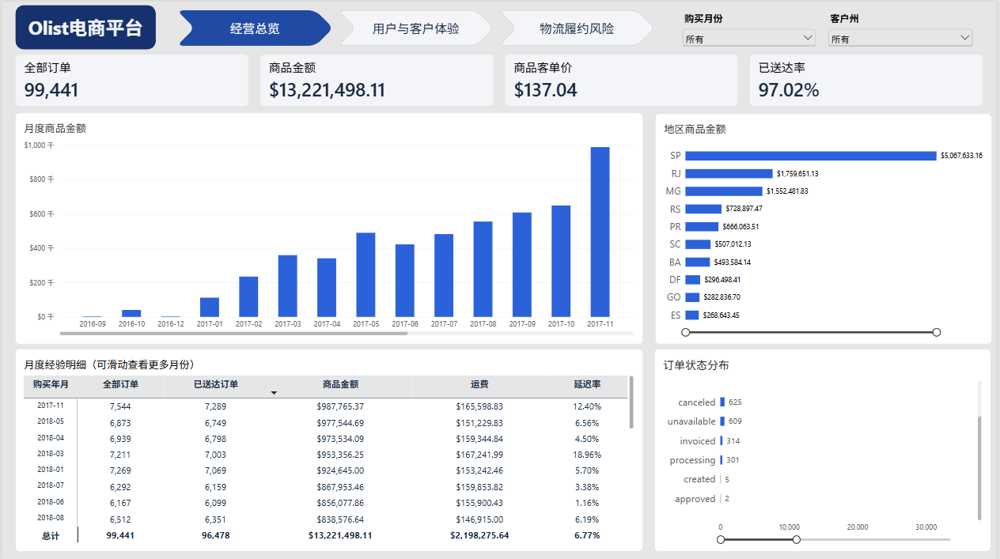
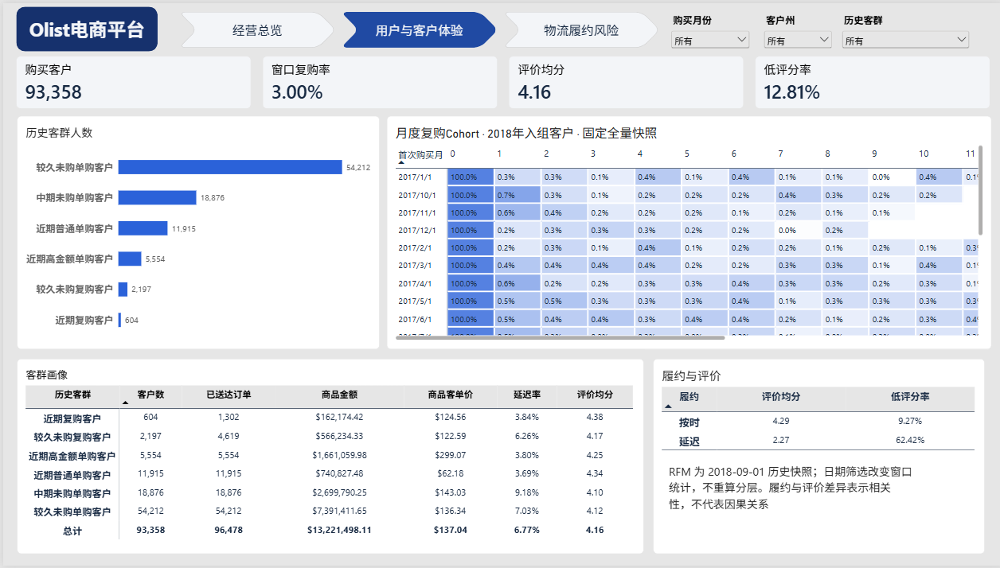
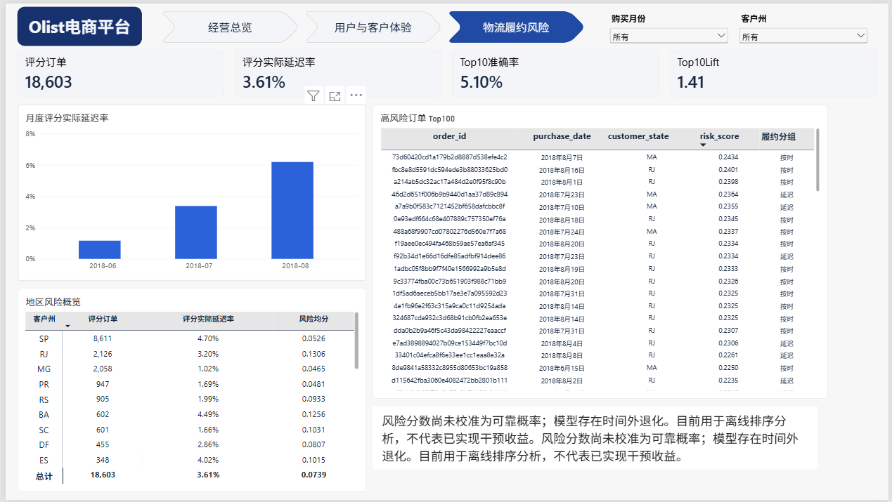
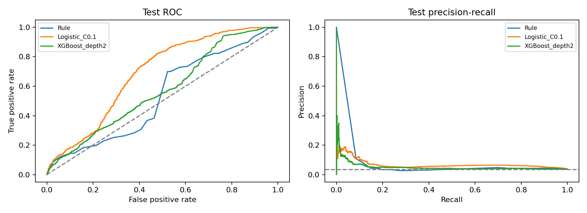
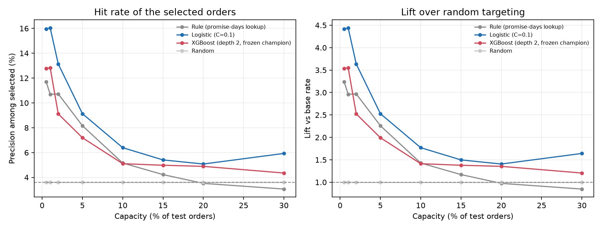

# Olist 电商经营分析与履约风险决策

> **个人数据分析项目｜SQL 数据建模 · Python 分析与机器学习 · Power BI / Web 看板 · 运营成本收益评估**

我基于 Olist 巴西电商公开数据，完成从多表质量审计、订单级数据集成，到客户分层、延迟风险建模、交互看板和运营策略评估的一套端到端分析。项目重点是让每个业务结论都能追溯到明确的数据口径、代码和结果文件，也如实记录模型在时间外测试中的退化。

**数据集：** Olist Brazilian E-Commerce Public Dataset，包括订单、客户、订单商品、支付、评价、商品、卖家、地理、类别翻译共 9 个 CSV原始表（其中99,441 笔订单、112,650 条商品明细）。

## 完成内容

| 模块 | 工作内容 | 方法与工具 | 主要交付 |
|---|---|---|---|
| 1. 数据质量与集成 | 检查键、缺失、关联完整性、时间异常；处理订单与商品、支付、评价、地理表的多表关系 | MySQL 8、SQL、主键和金额对账 | `mart_order` 订单宽表；质量、清洗和对账结果 |
| 2. 经营分析 | 建立订单、履约、月度、品类、地区和卖家指标 | CTE、窗口函数、12 条 SQL 查询；Python 执行查询、做对账和图表 | 经营分析工作簿、简报和图表 |
| 3. 客户价值与体验 | 建立规则型 RFM 六分层、购买 Cohort、复购和履约体验分析 | pandas、NumPy、分位规则、Wilson 区间 | 客户明细、分层画像、Cohort 表和体验分析 |
| 4. 延迟风险预测 | 比较规则、Logistic Regression、XGBoost；按时间训练、验证和测试，控制标签成熟与特征泄漏 | scikit-learn、XGBoost、pandas；ROC-AUC、AP、Brier、Top-K | 冻结模型、逐单分数、验证/测试指标、稳定性分析 |
| 5. 商业看板 | 整合经营、客户、履约与风险数据，借助Power BI 制作交互看板| Power BI| Power BI 文件与三页看板截图 |
| 6. 运营决策 | 将风险排序与处理容量、干预成本、潜在损失和实验可行性连接 | 随机/规则/模型 Top-K、盈亏平衡、敏感性分析、A/B 样本量 | 风险等级、策略比较、情景测算、实验设计和决策报告 |

数据流、每个模块的唯一权威产物、指标口径、字段字典与看板口径，统一见 [`docs/README.md`](docs/README.md)。

## 关键发现

- **延迟率 6.77%，月份之间相差 16 倍。** 2018 年 3 月 18.96%，6 月 1.16%。
- **用 2–3 月数据选出的模型，到 6–8 月就失效了。** 验证集 AP 0.3235 的 XGBoost，测试集 ROC-AUC 从 0.696 掉到 0.574，8 月 Top 10% Lift 0.94，低于随机。
- **延迟订单的差评率是按时订单的 6.7 倍。** 62.42% 对 9.27%。这是关联，不是因果结论。
- **风险排序能挑出延迟单，但覆盖不了人工成本。** Top 5% 命中 7.20%，同容量随机 3.61%；按人工基准假设，回本需要 111% 的命中率。
- **受名单流量限制，这个实验当前做不了。** Top 5% 每天约 10.3 单，检测 27% 的延迟率下降需要每组 1,876 单，约 363 天。
- **五个粒度的金额对得上。** 订单、月度、类别、地区、卖家均为 13,221,498.11 BRL。

模块六的金额都是按历史标签和假设参数算出的情景值，不是实际收益。项目未上线干预。

## 看板与成果

Power BI 文件见 [`dashboards/`](dashboards/)。Power BI Desktop 账号原因暂时无法分享交互面板。









## 使用工具

| 环节 | 工具 |
|---|---|
| 数据库与指标 | MySQL 8、SQL、CTE、窗口函数 |
| 清洗与分析 | Python、pandas、NumPy |
| 预测与验证 | scikit-learn、XGBoost 、joblib |
| 图表和报表 | Matplotlib、Excel、openpyxl |
| 交互展示 | Power BI |

模块四依赖版本见 [`requirements.txt`](requirements.txt) 和 `results/module4/05_run_config.json`。SQL 查询执行和连接使用 SQLAlchemy、PyMySQL。

## 项目结构

```text
sql/                   数据质量、清洗视图、分析表、对账、经营查询
src/                   模块三、四、六代码及共享筛选规则
models/                模块四冻结的 Logistic 与 XGBoost 模型
results/module1..4/    数据、经营、客户、模型结果
results/module6/       策略、收益情景、实验规划及汇总工作簿
figures/               模块三、四、六图表
dashboards/            Power BI 文件与三页看板截图
reports/               各模块分析报告
docs/                  流程、指标口径、字段字典与看板说明（单文件）
```


## 项目报告

- [模块一　数据清洗与集成](reports/01_数据清洗与集成.md)
- [模块二　经营分析与发现](reports/02_经营分析与发现.md)
- [模块三　用户价值与体验](reports/03_用户价值与体验.md)
- [模块四　履约风险预测](reports/04_履约风险预测.md)
- [模块五　商业看板](reports/05_商业看板.md)
- [模块六　运营决策与实验设计](reports/06_运营决策与实验设计.md)

